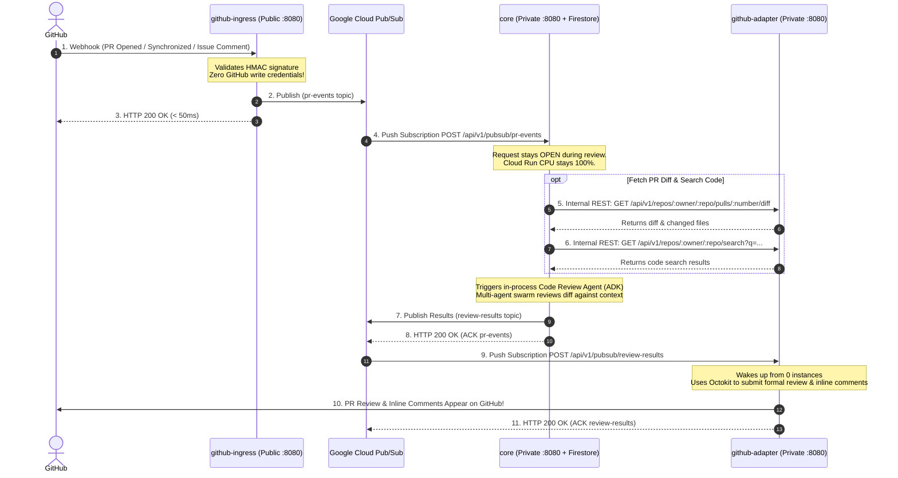

# Code Review Agent 🤖

A fully autonomous, context-aware AI Code Review system powered by [`@google/adk`](https://github.com/google/adk) and Google Gemini.

`code-review-agent` follows a decoupled, secure event-driven 3-service microservices architecture featuring a public webhook ingress (**`github-ingress`**), a private provider adapter (**`github-adapter`**), a centralized domain & persistence microservice (**`core`**), and in-process specialized AI agent domain libraries (**`agent-context-builder`** and **`agent-code-reviewer`**). Ingress is completely isolated with zero write credentials, communicating with Core asynchronously over Google Cloud Pub/Sub push subscriptions. Core queries the Adapter on-demand via internal REST tools (`search`, `diff`, `files`) and publishes review findings to Pub/Sub.

---

## 🌟 Key Features

- **Strict Security Boundaries**: `github-ingress` is public with **zero GitHub write tokens** and zero database credentials. Both `core` and `github-adapter` are completely private (`--ingress=internal`).
- **Pluggable Multi-Provider Architecture**: Easily swap or add provider adapters (GitHub, GitLab, Bitbucket) implementing common internal REST contracts and Pub/Sub event schemas.
- **On-Demand Code Search**: Agent tools query the provider adapter on-demand for repo searches and file contents without downloading heavy repo archives.
- **Context-Aware Reviews**: Automatically generates and continuously updates a full baseline architectural context of your codebase to eliminate hallucinations.
- **Agentic Multi-Role Swarm**: Spawns parallel specialized reviewers (Code Quality, Bug Detection, Ticket Alignment) using `@google/adk`.
- **Top-Level Summaries & Inline Comments**: Submits formal pull request reviews alongside actionable inline review comments directly to the Git provider.
- **Fail-Fast Environment Configuration**: Strict validation with zero silent default fallbacks on required environment variables.
- **Container-First CI/CD**: Multi-arch container images are automatically built and published to GHCR.

---

## 🏗️ Architecture



---

## 📂 Repository Structure

This monorepo is managed with [Nx](https://nx.dev) and [pnpm](https://pnpm.io):

```
code-review-agent/
├── apps/
│   ├── github-ingress/         # Public lightweight webhook receiver (zero write credentials)
│   ├── github-ingress-e2e/     # Cucumber/Gherkin BDD integration tests for GitHub Ingress
│   ├── github-adapter/         # Private GitHub REST API (diff, search, files) & comment publisher
│   ├── github-adapter-e2e/     # Cucumber/Gherkin BDD integration tests for GitHub Adapter
│   ├── core/                   # Domain logic, Firestore persistence & in-process ADK orchestration
│   └── core-e2e/               # Cucumber/Gherkin BDD integration tests for Core
├── libs/
│   ├── agent-context-builder/  # ADK agent library for repo indexing & baseline context
│   ├── agent-code-reviewer/    # ADK agent library for diff review & inline findings
│   ├── pubsub/                 # Abstract Pub/Sub consumer & push envelope parsing utilities
│   ├── env/                    # Type-safe environment manager with eager Zod schema validation
│   └── shared-types/           # Common domain TypeScript interfaces & schemas
├── .github/
│   └── workflows/
│       ├── ci.yml              # Lint, typecheck, unit tests, E2E tests, build dry-runs
│       └── release.yml         # Builds & publishes multi-arch container images to GHCR
└── docker-compose.yml          # Complete local development stack with emulators
```

---

## 📦 Published Container Images

Every merge to `main` and version tag (`v*.*.*`) automatically publishes multi-architecture (`linux/amd64`, `linux/arm64`) images to GitHub Container Registry (GHCR):

| Service            | Container Image                                           | Description                                                         |
| :----------------- | :-------------------------------------------------------- | :------------------------------------------------------------------ |
| **GitHub Ingress** | `ghcr.io/<owner>/code-review-agent-github-ingress:latest` | Public webhook receiver (validates HMAC, publishes to Pub/Sub)      |
| **GitHub Adapter** | `ghcr.io/<owner>/code-review-agent-github-adapter:latest` | Private provider adapter (search, diff, files, and review egress)   |
| **Core Service**   | `ghcr.io/<owner>/code-review-agent-core:latest`           | Firestore database state, workflow orchestration, in-process agents |

---

## 🚀 Quickstart: Local Development

You can run the entire system locally with Docker Compose, which includes Firestore and Pub/Sub emulators:

```bash
# 1. Clone the repository
git clone https://github.com/<owner>/code-review-agent.git
cd code-review-agent

# 2. Copy and customize the environment file
cp .env.example .env

# Edit .env with your Google Gemini API key and GitHub credentials:
# - GEMINI_API_KEY
# - GITHUB_TOKEN
# - GITHUB_WEBHOOK_SECRET

# 3. Start the entire stack
docker compose up --build
```

The services will be available locally:

- **GitHub Gateway**: `http://localhost:3000` (Healthcheck: `http://localhost:3000/healthz`)
- **Core Service**: `http://localhost:3001` (Healthcheck: `http://localhost:3001/healthz`)
- **Firestore Emulator**: `localhost:8081`
- **Pub/Sub Emulator**: `localhost:8085`

---

## 🏢 Production Deployment Strategy: Separate Private Ops Repo

### Why a Separate Private Deployment Repository?

This codebase is intentionally designed as an open-source / application repository that publishes versioned container images. We strongly recommend deploying via a **separate private repository** (e.g. `code-review-agent-deploy` or internal GitOps / infrastructure repo).

This approach provides:

1. **Security & Credential Isolation**: Keep cloud infrastructure credentials, service account keys, GitHub tokens, and `.env` secrets private.
2. **Infrastructure Independence**: Deploy to Google Cloud Run, GKE / Kubernetes (Helm / ArgoCD), AWS ECS, or self-hosted Docker Compose without modifying application code.
3. **Immutable Releases**: Pin deployments to specific immutable semantic tags (e.g. `:v1.2.0` or `:sha-<commit>`) published by this repository.

### Setting Up the Private Deployment Repository

A private deployment repository typically contains:

```
code-review-agent-deploy/ (Private Repo)
├── .github/workflows/
│   └── deploy.yml               # Deployment workflow (Cloud Run, K8s, or SSH/Docker)
├── environments/
│   ├── production.env           # Injected production secrets & config
│   └── staging.env
├── terraform/                   # Optional: GCP/AWS infrastructure provisioning
│   ├── firestore.tf
│   └── pubsub.tf
└── docker-compose.prod.yml       # Production Compose or Kubernetes manifests
```

#### Private Repo Recommended Layout

```text
code-review-agent-deploy/
├── .github/
│   └── workflows/
│       └── deploy.yml               # Automated Cloud Run deployment workflow
├── scripts/
│   └── setup-gcp-infra.sh           # Idempotent GCP setup (APIs, Firestore, Pub/Sub topics, push subscriptions)
├── terraform/                       # Optional: Declarative Terraform configuration
│   ├── main.tf
│   ├── variables.tf
│   └── outputs.tf
├── docker-compose.prod.yml          # Production Compose for VM / on-premise deployments
├── .env.example                     # Reference template for production secrets & config
└── README.md                        # Deployment instructions & ops runbook
```

---

### 📋 Ready-to-Use Artifacts for Your Private Deployment Repo

#### 1. Cloud Run CI/CD Workflow (`.github/workflows/deploy.yml`)

This automated workflow deploys all 4 microservices to Cloud Run and configures the Pub/Sub push subscriptions with OIDC authentication:

```yaml
name: Deploy Code Review Agent to Cloud Run

on:
  workflow_dispatch:
  push:
    branches: [main]

env:
  GCP_REGION: ${{ vars.GCP_REGION || 'us-central1' }}
  GCP_PROJECT_ID: ${{ vars.GCP_PROJECT_ID }}
  IMAGE_OWNER: ${{ vars.IMAGE_OWNER }}
  IMAGE_TAG: ${{ vars.IMAGE_TAG || 'latest' }}

jobs:
  deploy:
    runs-on: ubuntu-latest
    steps:
      - name: Authenticate to Google Cloud
        uses: google-github-actions/auth@v2
        with:
          credentials_json: ${{ secrets.GCP_SA_KEY }}

      - name: Set up Cloud SDK
        uses: google-github-actions/setup-gcloud@v2

      # 1. Deploy Core Service (Private)
      - name: Deploy Core Service
        run: |
          gcloud run deploy core-service \
            --image "ghcr.io/${{ env.IMAGE_OWNER }}/code-review-agent-core:${{ env.IMAGE_TAG }}" \
            --region "${{ env.GCP_REGION }}" \
            --platform managed \
            --no-allow-unauthenticated \
            --ingress internal \
            --memory 2Gi \
            --cpu 2 \
            --no-cpu-throttling \
            --timeout 900 \
            --service-account "code-review-agent-sa@${{ env.GCP_PROJECT_ID }}.iam.gserviceaccount.com" \
            --set-env-vars "PORT=8080,HOST=0.0.0.0,REVIEW_RESULTS_TOPIC=review-results,REVIEW_MODEL=${{ vars.REVIEW_MODEL || 'gemini-3.8-flash' }},GEMINI_API_KEY=${{ secrets.GEMINI_API_KEY }},GOOGLE_CLOUD_PROJECT=${{ env.GCP_PROJECT_ID }}"

      # 2. Deploy GitHub Adapter (Private Provider Adapter)
      - name: Deploy GitHub Adapter
        run: |
          gcloud run deploy github-adapter \
            --image "ghcr.io/${{ env.IMAGE_OWNER }}/code-review-agent-github-adapter:${{ env.IMAGE_TAG }}" \
            --region "${{ env.GCP_REGION }}" \
            --platform managed \
            --no-allow-unauthenticated \
            --ingress internal \
            --memory 512Mi \
            --cpu 1 \
            --no-cpu-throttling \
            --service-account "code-review-agent-sa@${{ env.GCP_PROJECT_ID }}.iam.gserviceaccount.com" \
            --set-env-vars "PORT=8080,HOST=0.0.0.0,GITHUB_TOKEN=${{ secrets.GITHUB_TOKEN }},GOOGLE_CLOUD_PROJECT=${{ env.GCP_PROJECT_ID }}"

      # 3. Deploy GitHub Ingress (Public Webhook Receiver, Zero Write Credentials)
      - name: Deploy GitHub Ingress
        run: |
          gcloud run deploy github-ingress \
            --image "ghcr.io/${{ env.IMAGE_OWNER }}/code-review-agent-github-ingress:${{ env.IMAGE_TAG }}" \
            --region "${{ env.GCP_REGION }}" \
            --platform managed \
            --allow-unauthenticated \
            --memory 256Mi \
            --cpu 1 \
            --service-account "code-review-agent-sa@${{ env.GCP_PROJECT_ID }}.iam.gserviceaccount.com" \
            --set-env-vars "PORT=8080,HOST=0.0.0.0,GITHUB_WEBHOOK_SECRET=${{ secrets.GITHUB_WEBHOOK_SECRET }},PR_EVENTS_TOPIC=pr-events,GOOGLE_CLOUD_PROJECT=${{ env.GCP_PROJECT_ID }}"

      # 4. Configure Pub/Sub Push Subscriptions (enables scale-to-zero wake-up)
      - name: Configure Pub/Sub Push Subscriptions
        run: |
          CORE_URL=$(gcloud run services describe core-service --region "${{ env.GCP_REGION }}" --format 'value(status.url)')
          ADAPTER_URL=$(gcloud run services describe github-adapter --region "${{ env.GCP_REGION }}" --format 'value(status.url)')

          # 1. PR Events Push Subscription to Core
          # max-delivery-attempts + dead-letter-topic stop poison messages from
          # redelivering forever (each redelivery of a review costs real LLM spend).
          # Core runs the review inside the push request. The review aborts
          # itself after 8 minutes — under the 600s ack deadline and the 900s
          # Cloud Run --timeout — but a cold baseline build can push the total
          # past the ack deadline. Pub/Sub then redelivers while the first
          # attempt is still running; the messageId dedup acks the redelivery,
          # so if Cloud Run kills the original at 900s the event is lost until
          # the next webhook for that PR (known gap for cold-repo events).
          gcloud pubsub subscriptions create pr-events-sub \
            --topic=pr-events \
            --push-endpoint="${CORE_URL}/api/v1/pubsub/pr-events" \
            --push-auth-service-account="code-review-agent-sa@${{ env.GCP_PROJECT_ID }}.iam.gserviceaccount.com" \
            --ack-deadline=600 \
            --max-delivery-attempts=3 \
            --dead-letter-topic="projects/${{ env.GCP_PROJECT_ID }}/topics/pr-events-dlq" \
            --min-retry-delay=30s \
            --max-retry-delay=600s || \
          gcloud pubsub subscriptions update pr-events-sub \
            --push-endpoint="${CORE_URL}/api/v1/pubsub/pr-events" \
            --push-auth-service-account="code-review-agent-sa@${{ env.GCP_PROJECT_ID }}.iam.gserviceaccount.com" \
            --ack-deadline=600 \
            --max-delivery-attempts=3 \
            --dead-letter-topic="projects/${{ env.GCP_PROJECT_ID }}/topics/pr-events-dlq" \
            --min-retry-delay=30s \
            --max-retry-delay=600s

          # 2. Review Results Push Subscription to Adapter
          gcloud pubsub subscriptions create review-results-sub \
            --topic=review-results \
            --push-endpoint="${ADAPTER_URL}/api/v1/pubsub/review-results" \
            --push-auth-service-account="code-review-agent-sa@${{ env.GCP_PROJECT_ID }}.iam.gserviceaccount.com" \
            --ack-deadline=60 \
            --max-delivery-attempts=5 \
            --dead-letter-topic="projects/${{ env.GCP_PROJECT_ID }}/topics/review-results-dlq" \
            --min-retry-delay=30s \
            --max-retry-delay=600s || \
          gcloud pubsub subscriptions update review-results-sub \
            --push-endpoint="${ADAPTER_URL}/api/v1/pubsub/review-results" \
            --push-auth-service-account="code-review-agent-sa@${{ env.GCP_PROJECT_ID }}.iam.gserviceaccount.com" \
            --ack-deadline=60 \
            --max-delivery-attempts=5 \
            --dead-letter-topic="projects/${{ env.GCP_PROJECT_ID }}/topics/review-results-dlq" \
            --min-retry-delay=30s \
            --max-retry-delay=600s

          # Dead-lettering also needs the Pub/Sub service agent to be able to
          # ack the failed message on the source subscription; without this
          # binding max-delivery-attempts does not stop redelivery.
          PROJECT_NUMBER=$(gcloud projects describe "${{ env.GCP_PROJECT_ID }}" --format 'value(projectNumber)')
          for SUB in pr-events-sub review-results-sub; do
            gcloud pubsub subscriptions add-iam-policy-binding "${SUB}" \
              --member="serviceAccount:service-${PROJECT_NUMBER}@gcp-sa-pubsub.iam.gserviceaccount.com" \
              --role="roles/pubsub.subscriber" --quiet
          done
```

---

#### 2. Infrastructure Setup Script (`scripts/setup-gcp-infra.sh`)

Run this idempotent script once in your private repo to initialize Firestore, Pub/Sub topics, and IAM permissions:

```bash
#!/usr/bin/env bash
set -euo pipefail

# Configuration
PROJECT_ID="${GCP_PROJECT_ID:-$(gcloud config get-value project)}"
REGION="${GCP_REGION:-us-central1}"
SA_NAME="code-review-agent-sa"
SA_EMAIL="${SA_NAME}@${PROJECT_ID}.iam.gserviceaccount.com"

echo "Setting up GCP infrastructure for Project: ${PROJECT_ID} in Region: ${REGION}..."

# 1. Enable required GCP APIs
echo "Enabling GCP APIs..."
gcloud services enable \
  run.googleapis.com \
  pubsub.googleapis.com \
  firestore.googleapis.com \
  iam.googleapis.com

# 2. Provision Firestore in Native mode (if not already existing)
echo "Checking Firestore database..."
if ! gcloud firestore databases describe --database="(default)" &>/dev/null; then
  echo "Creating Firestore (default) database in Native mode..."
  gcloud firestore databases create --location="${REGION}" --type=firestore-native
else
  echo "Firestore database already exists."
fi

# TTL for the Pub/Sub delivery-dedup records (processed_deliveries): claims
# expire on their own so the collection does not grow without bound.
echo "Configuring TTL on processed_deliveries..."
gcloud firestore fields update ttl \
  --collection-group=processed_deliveries \
  --field-path=startedAt \
  --ttl-duration=86400s || echo "TTL update skipped (already configured?)."

# 3. Create Pub/Sub Topics (including dead-letter topics for poison messages)
echo "Creating Pub/Sub topics..."
for TOPIC in pr-events review-results pr-events-dlq review-results-dlq; do
  if ! gcloud pubsub topics describe "${TOPIC}" &>/dev/null; then
    gcloud pubsub topics create "${TOPIC}"
    echo "Created topic: ${TOPIC}"
  else
    echo "Topic ${TOPIC} already exists."
  fi
done

# Dead-lettering publishes as the Pub/Sub service agent — it needs publisher
# rights on the DLQ topics or dead-lettering silently fails.
PROJECT_NUMBER=$(gcloud projects describe "${PROJECT_ID}" --format='value(projectNumber)')
for DLQ in pr-events-dlq review-results-dlq; do
  gcloud pubsub topics add-iam-policy-binding "${DLQ}" \
    --member="serviceAccount:service-${PROJECT_NUMBER}@gcp-sa-pubsub.iam.gserviceaccount.com" \
    --role="roles/pubsub.publisher" --quiet
done

# A topic with no subscription drops what it receives: give each DLQ a pull
# subscription so dead-lettered events are kept (7 days) for inspection/replay.
for DLQ in pr-events-dlq review-results-dlq; do
  if ! gcloud pubsub subscriptions describe "${DLQ}-sub" &>/dev/null; then
    gcloud pubsub subscriptions create "${DLQ}-sub" \
      --topic="${DLQ}" --message-retention-duration=7d
  fi
done

# 4. Create Service Account
echo "Configuring Service Account: ${SA_EMAIL}..."
if ! gcloud iam service-accounts describe "${SA_EMAIL}" &>/dev/null; then
  gcloud iam service-accounts create "${SA_NAME}" \
    --display-name="Code Review Agent Service Account"
fi

# 5. Grant IAM roles to Service Account
echo "Granting IAM roles to ${SA_EMAIL}..."
ROLES=(
  "roles/datastore.user"
  "roles/pubsub.publisher"
  "roles/pubsub.subscriber"
  "roles/run.invoker"
)
for ROLE in "${ROLES[@]}"; do
  gcloud projects add-iam-policy-binding "${PROJECT_ID}" \
    --member="serviceAccount:${SA_EMAIL}" \
    --role="${ROLE}" --quiet
done

echo "GCP Infrastructure setup complete! You are ready to deploy."
```

---

#### 3. Declarative Terraform Configuration (`terraform/main.tf`)

If your team prefers Terraform, include this in `terraform/main.tf`:

```hcl
terraform {
  required_version = ">= 1.5.0"
  required_providers {
    google = {
      source  = "hashicorp/google"
      version = "~> 5.0"
    }
  }
}

variable "project_id" {
  description = "Google Cloud Project ID"
  type        = string
}

variable "region" {
  description = "Default Google Cloud Region"
  type        = string
  default     = "us-central1"
}

provider "google" {
  project = var.project_id
  region  = var.region
}

# 1. Enable APIs
resource "google_project_service" "apis" {
  for_each = toset([
    "run.googleapis.com",
    "pubsub.googleapis.com",
    "firestore.googleapis.com",
    "iam.googleapis.com",
  ])
  service = each.key
  disable_on_destroy = false
}

# 2. Firestore Database
resource "google_firestore_database" "database" {
  name        = "(default)"
  location_id = var.region
  type        = "FIRESTORE_NATIVE"
  depends_on  = [google_project_service.apis]
}

# 3. Pub/Sub Topics
resource "google_pubsub_topic" "topics" {
  for_each = toset([
    "pr-events",
    "review-results",
    "pr-events-dlq",
    "review-results-dlq",
  ])
  name       = each.key
  depends_on = [google_project_service.apis]
}

# 4. Service Account & IAM Roles
resource "google_service_account" "agent_sa" {
  account_id   = "code-review-agent-sa"
  display_name = "Code Review Agent Service Account"
}

resource "google_project_iam_member" "sa_roles" {
  for_each = toset([
    "roles/datastore.user",
    "roles/pubsub.publisher",
    "roles/pubsub.subscriber",
    "roles/run.invoker",
  ])
  project = var.project_id
  role    = each.key
  member  = "serviceAccount:${google_service_account.agent_sa.email}"
}
```

---

#### 4. Docker Compose for Self-Hosted Deployments (`docker-compose.prod.yml`)

For teams running on a single cloud VM or on-premise Docker host:

```yaml
version: '3.8'

services:
  adapter:
    image: ghcr.io/<owner>/code-review-agent-github-adapter:latest
    restart: always
    environment:
      - PORT=8080
      - HOST=0.0.0.0
      - GITHUB_TOKEN=${GITHUB_TOKEN}
      - GOOGLE_CLOUD_PROJECT=${GOOGLE_CLOUD_PROJECT}

  core:
    image: ghcr.io/<owner>/code-review-agent-core:latest
    restart: always
    environment:
      - PORT=8080
      - HOST=0.0.0.0
      - REVIEW_RESULTS_TOPIC=review-results
      - REVIEW_MODEL=gemini-3.8-flash
      - GEMINI_API_KEY=${GEMINI_API_KEY}
      - GIT_ADAPTER_URL=http://adapter:8080
      - GOOGLE_CLOUD_PROJECT=${GOOGLE_CLOUD_PROJECT}
```

---

### 🤖 Instructions to Pass to an Autonomous AI Agent

If you want an AI agent (such as Antigravity, Claude, Cursor, or Devin) to build and populate your private deployment repository from scratch, copy and paste this prompt:

```markdown
Please create a new private GitOps deployment repository named `code-review-agent-deploy` for the `code-review-agent` system.

The application publishes 2 multi-arch container images to GitHub Container Registry (GHCR):

- `ghcr.io/<owner>/code-review-agent-github-gateway:latest`
- `ghcr.io/<owner>/code-review-agent-core:latest`

Please generate the complete, production-ready repository with the following files:

1. `.github/workflows/deploy.yml`:
   - Deploys both services to Google Cloud Run in this order: Core, Gateway.
   - Configures the 2 Pub/Sub pull subscriptions:
     - `pr-events-sub` (subscribes to `pr-events` topic)
     - `review-results-sub` (subscribes to `review-results` topic)

2. `scripts/setup-gcp-infra.sh`:
   - Idempotent bash script to enable GCP APIs (`run`, `pubsub`, `firestore`, `iam`).
   - Creates Firestore native database `(default)`.
   - Creates the 2 Pub/Sub topics: `pr-events`, `review-results`.
   - Provisions `code-review-agent-sa` service account with `roles/datastore.user`, `roles/pubsub.publisher`, `roles/pubsub.subscriber`, and `roles/run.invoker`.

3. `terraform/main.tf`, `terraform/variables.tf`, `terraform/outputs.tf`:
   - Full Terraform declarations equivalent to `setup-gcp-infra.sh`.

4. `docker-compose.prod.yml`:
   - Production Docker Compose setup running both services referencing the GHCR images.

5. `.env.example`:
   - Complete template documenting all required secrets: `GITHUB_WEBHOOK_SECRET`, `GITHUB_TOKEN`, `GEMINI_API_KEY`, `GCP_PROJECT_ID`, and `GCP_REGION`.

6. `README.md`:
   - Step-by-step instructions on setting GitHub repository secrets/variables, running the infra setup, and triggering the deployment workflow.
```

## ⚙️ Environment Variables Reference

Each service strictly validates required variables and fails fast at startup if any are missing.

### GitHub Ingress (`apps/github-ingress`)

| Variable                | Required | Description                                                          |
| :---------------------- | :------: | :------------------------------------------------------------------- |
| `PORT`                  |   Yes    | Port to listen on (e.g. `8080`)                                      |
| `HOST`                  |   Yes    | Host interface to bind to (e.g. `0.0.0.0`)                           |
| `GITHUB_WEBHOOK_SECRET` |   Yes    | Secret string used to verify incoming GitHub webhook HMAC signatures |
| `PR_EVENTS_TOPIC`       | Optional | Google Cloud Pub/Sub topic to publish PR events to                   |
| `GOOGLE_CLOUD_PROJECT`  | Optional | GCP Project ID (auto-detected when running in GCP)                   |

### GitHub Adapter (`apps/github-adapter`)

| Variable               | Required | Description                                                                          |
| :--------------------- | :------: | :----------------------------------------------------------------------------------- |
| `PORT`                 |   Yes    | Port to listen on (e.g. `8080`)                                                      |
| `HOST`                 |   Yes    | Host interface to bind to (e.g. `0.0.0.0`)                                           |
| `GITHUB_TOKEN`         |   Yes    | GitHub Personal Access Token (classic with `repo` scope) for diff, search & comments |
| `GOOGLE_CLOUD_PROJECT` | Optional | GCP Project ID (auto-detected when running in GCP)                                   |

### Core Service (`apps/core`)

| Variable                  | Required | Description                                                                         |
| :------------------------ | :------: | :---------------------------------------------------------------------------------- |
| `PORT`                    |   Yes    | Port to listen on (e.g. `8080`)                                                     |
| `HOST`                    |   Yes    | Host interface to bind to (e.g. `0.0.0.0`)                                          |
| `REVIEW_RESULTS_TOPIC`    |   Yes    | Google Cloud Pub/Sub topic to publish review result events to                       |
| `REVIEW_MODEL`            |   Yes    | Gemini model identifier (e.g. `gemini-3.8-flash`)                                   |
| `GIT_ADAPTER_URL`         |   Yes    | URL of Git Provider Adapter for on-demand code queries (e.g. `http://adapter:8080`) |
| `GEMINI_API_KEY`          | Optional | Google Gemini API key (required if not using Google Cloud ADC / Vertex AI)          |
| `GOOGLE_CLOUD_PROJECT`    | Optional | GCP Project ID (auto-detected when running in GCP)                                  |
| `FIRESTORE_EMULATOR_HOST` | Optional | Host of local Firestore emulator for dev/testing (e.g. `localhost:8081`)            |
| `PUBSUB_EMULATOR_HOST`    | Optional | Host of local Pub/Sub emulator for dev/testing (e.g. `localhost:8085`)              |

---

## 🔗 GitHub Webhook Configuration

In your GitHub repository (or organization) settings under **Webhooks** → **Add webhook**:

1. **Payload URL**: `https://<YOUR_INGRESS_URL>/api/v1/webhooks`
2. **Content type**: `application/json`
3. **Secret**: Value matching `GITHUB_WEBHOOK_SECRET`
4. **Events to trigger**:
   - `Pull requests`
   - `Issue comments`

---

## 🛠️ Monorepo Development Commands

```bash
# Install dependencies
pnpm install

# Run linting across all projects
pnpm run lint

# Check code formatting with Prettier
pnpm run format:check

# Automatically format all files with Prettier
pnpm run format

# Run TypeScript typechecks across all projects
pnpm run typecheck

# Run unit tests across all projects
pnpm run test

# Run end-to-end BDD tests (Cucumber / Gherkin)
pnpm run e2e

# Build all microservices
pnpm run build

# Build individual Docker images locally
pnpm run docker:build:github-ingress
pnpm run docker:build:github-adapter
pnpm run docker:build:core
```

---

## 📄 License

MIT
